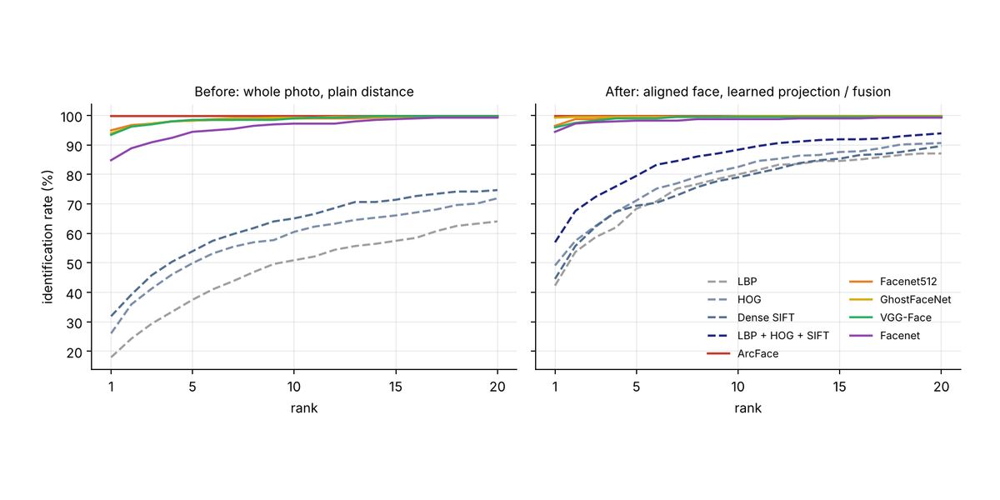
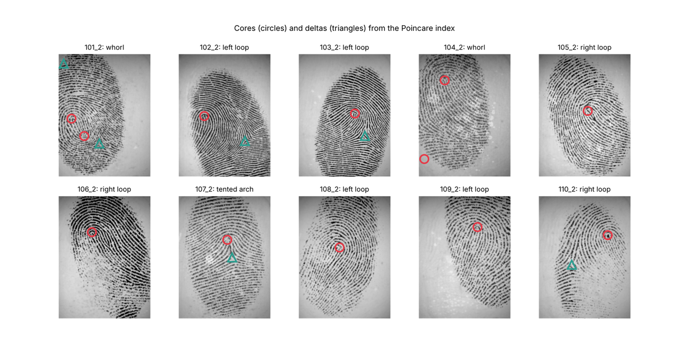
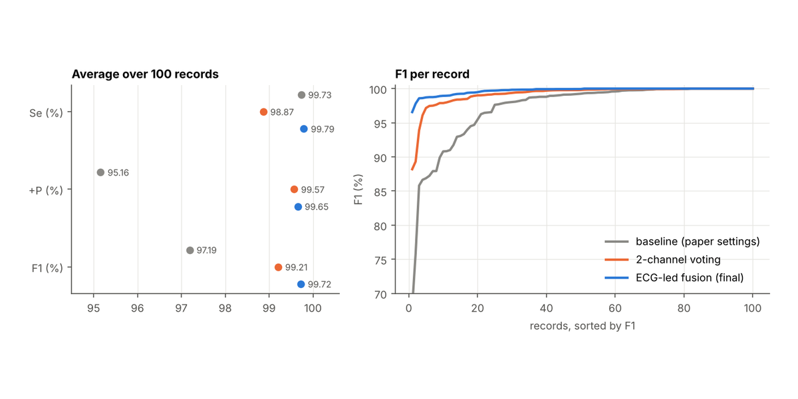

<h1 align="center">Sara Mihalič</h1>

  AI security · computer vision · biometrics · biomedical signals · algorithms · full stack

## Projects

<table>
<tr>
<td width="50%" valign="top">

<b><a href="https://github.com/flp413/face-recognition-benchmark">face-recognition-benchmark</a></b> 
Hand-crafted features vs deep embeddings. <b>99.7% Rank-1</b>.
</td>
<td width="50%" valign="top">

<b><a href="https://github.com/flp413/fingerprint-verification-benchmark">fingerprint-verification-benchmark</a></b> 
NIST NBIS on eight FVC sets. <b>Error rate 5.3% → 1.0%</b>.
</td>
</tr>
<tr>
<td width="50%" valign="top">

<b><a href="https://github.com/flp413/multimodal-heartbeat-detection">multimodal-heartbeat-detection</a></b> 
ECG and blood pressure fusion. <b>F1 99.7%</b> on PhysioNet 2014.
</td>
<td width="50%" valign="top">

<b><a href="https://github.com/flp413/ct-edge-detection-canny-3d">ct-edge-detection-canny-3d</a></b> 
Canny from scratch with 3D edge linking. <b>99.7% match</b> with OpenCV.
</td>
</tr>
<tr>
<td width="50%" valign="top">
<b><a href="https://github.com/FEUP-LGP-2026/SC28">Applix</a></b> (team project) 
Mobile app in React Native with a NestJS and PostgreSQL backend.
</td>
<td width="50%" valign="top">
<b><a href="https://github.com/flp413/Spica-Challenge">Spica-Challenge</a></b> 
Angular app for Špica International on the AllHours REST API.
</td>
</tr>
</table>

## Skills

<table>
<tr><td><b>Languages</b></td><td>       </td></tr>
<tr><td><b>ML and data</b></td><td>     </td></tr>
<tr><td><b>Web and mobile</b></td><td>     </td></tr>
<tr><td><b>Tools</b></td><td>     </td></tr>
</table>

## Contacts

  
I'm always open to interesting conversations and opportunities. Especially in person :) 

  
  

